# pywget

[](https://github.com/cumulus13/pywget/actions/workflows/ci.yml)
[](https://pypi.org/project/pywget/)
[](https://pypi.org/project/pywget/)
[](LICENSE)

A robust, resumable, **multi-connection** command-line downloader and Python library.
A drop-in-style `wget` alternative with zero third-party dependencies.

## Features

| Area | What you get |
|------|--------------|
| Speed | Parallel segmented download (`-n 1..32`), automatic single-stream fallback |
| Reliability | Crash-safe resume, retries with exponential backoff + jitter, `Retry-After`, atomic rename |
| Integrity | `--checksum sha256:...`, size verification, disk-space pre-check |
| Security | http/https only, credentials stripped on cross-origin redirects, path-traversal-proof filenames, TLS verification on by default |
| Control | Bandwidth limit, custom headers, basic auth, proxy, custom CA, timeouts |
| Automation | Batch input (`-i`), `--json` output, stable exit codes, SIGINT/SIGTERM-safe |
| Server mode | `pywget serve`: persistent queue, HTTP/JSON API, SSE events, web UI, token auth |
| Agent mode | `pywget agent` / `--server`: send links from anywhere; offline-tolerant relay to a server |
| Library | Typed API, progress callbacks, cancel support, legacy `wget.download()` kept |
| Portability | Python 3.8+, Windows / Linux / macOS, no dependencies |

## Installation

```bash
pip install pywget
```

> **v2 note:** Python 2 is no longer supported. Python 3.8+ is required. The CLI and
> `wget.download(url, dir)` keep working as before.

## Quick start

```bash
# simple download into a directory (same as before)
pywget "https://example.com/file.iso" -p ~/Downloads

# 8 parallel connections, 2 MiB/s cap, verify checksum
pywget https://example.com/file.iso -n 8 --limit-rate 2M --checksum sha256:<hex>

# many URLs from a file (or stdin with -i -), JSON report
pywget -i urls.txt -p downloads --json

# auth + custom header
pywget https://api.example.com/export.zip --user me -H "Accept: application/zip"
```

```bash
# download manager mode: run a server, push links to it (see "Server mode and agent")
pywget serve --root ~/Downloads/pywget &
pywget send https://example.com/file.iso -r https://example.com/ --wait
pywget jobs list
pywget jobs watch                     # live status (polling)
```

Interrupted (Ctrl+C, crash, network loss)? Run the same command again - it resumes.

## CLI reference

| Option | Description |
|--------|-------------|
| `URL ...` | http(s) URLs, `c` = read links from the clipboard, or a text file of links |
| `-i, --input-file FILE` | Read URLs from file (`-` = stdin); `#` comments allowed |
| `-p, -P, --path DIR` | Download directory (default `.`) |
| `-O, --output NAME` | Output file name (single URL) |
| `-n, --connections N` | Parallel connections per file, 1-32 (default 4) |
| `-t, --retries N` | Retries per request/segment (default 5) |
| `-r, --referrer URL` | Referer header (many sites require it) |
| `-C, --cookie STR` | Cookie string `a=b; c=d` or JSON object |
| `-T, --timeout SEC` | Network timeout (default 30) |
| `--limit-rate RATE` | Total speed cap, e.g. `500k`, `2M` |
| `-H, --header 'K: V'` | Extra header (repeatable) |
| `-U, -ua, --user-agent UA` | Custom User-Agent |
| `--user`, `--password` | Basic auth (password also from `PYWGET_PASSWORD` or prompt) |
| `--proxy URL` | Proxy (default: environment) |
| `--no-check-certificate` | Disable TLS verification (not recommended) |
| `--ca-cert FILE` | Custom CA bundle |
| `--checksum ALGO:HEX` | Verify result (md5, sha1, sha256, sha512, ...) |
| `--overwrite` | Replace existing file and restart |
| `--no-resume` | Never resume partial files |
| `--no-mtime` | Do not copy `Last-Modified` to the file |
| `-q`, `-v` | Quiet / debug logging |
| `--json` | Machine-readable results on stdout |
| `-c` | Accepted for wget compatibility (resume is default) |
| `-s, --server URL` | Send the links to a pywget server/agent instead of downloading locally |
| `--token TOKEN` | API token for `--server` (default: `$PYWGET_TOKEN` or token file) |
| `-a, --add-only` | With `--server`: queue paused, do not start (like IDM's *add*) |
| `--wait` | With `--server`: wait for the jobs to finish |

### Exit codes

| Code | Meaning |
|------|---------|
| 0 | Success |
| 1 | Unexpected error |
| 2 | Bad usage / invalid URL |
| 3 | Network error |
| 4 | HTTP error status (404, 403, ...) |
| 5 | Checksum mismatch |
| 6 | Storage / I/O error (disk full, permissions) |
| 7 | Server / agent error (unreachable, 401, 409, ...) |
| 130 | Interrupted (partial data kept for resume) |

## Python API

```python
import pywget

path = pywget.download(
    "https://example.com/file.iso",
    "/data/downloads",
    progress=True,          # terminal bar
    connections=8,
    limit_rate="5M",
    checksum="sha256:ab12...",
)
print(path)
```

Full control:

```python
from pywget import Downloader, Options, ProgressInfo

def on_progress(p: ProgressInfo) -> None:
    print(f"{p.filename}: {p.percent or 0:.1f}%  {p.speed/1e6:.1f} MB/s  ETA {p.eta}")

dl = Downloader(Options(output_dir="out", retries=8, progress=on_progress,
                        headers={"Authorization": "Bearer TOKEN"}))
result = dl.fetch("https://example.com/big.bin")
print(result.path, result.size, result.resumed, result.connections)

# from another thread: dl.cancel()  -> partial state is kept for resume
```

Talk to a server / agent, or embed one:

```python
from pywget import ServerClient, ServerConfig, ServerHandle

client = ServerClient("http://127.0.0.1:8765")      # token: $PYWGET_TOKEN or token file
job = client.submit({"url": "https://example.com/f.iso", "path": "isos"})[0]
print(client.wait(job["id"])["status"])

cfg = ServerConfig(port=0, token="secret-token", root="/srv/dl", state_dir="/var/lib/pywget")
with ServerHandle(cfg) as server:                    # background server (tests, embedding)
    print(server.url)
```

Legacy API (unchanged):

```python
from pywget import wget

wget.download("http://www.test.com/test.tar.gz", "/home/root/Downloads")
```

Errors derive from `pywget.PywgetError` (`InvalidURLError`, `NetworkError`,
`HTTPStatusError`, `ChecksumError`, `StorageError`, `DownloadCancelled`).
A `Downloader` runs one download at a time - use one instance per thread.

## Configuration and API token

### Config file (optional)

There is no config file unless you create one; every option also has a command-line flag.

```bash
pywget config path     # where it lives
pywget config init     # write a fully commented template there (mode 0600)
pywget config show
```

| OS | Default location |
|----|------------------|
| Windows | `%APPDATA%\pywget\config.ini` |
| Linux / macOS | `~/.config/pywget/config.ini` (`$XDG_CONFIG_HOME` respected) |

Override the directory with `PYWGET_CONFIG_DIR` or the file with `PYWGET_CONFIG`.
Precedence: **command line > environment > config file > built-in defaults**.
Sections: `[download]`, `[client]`, `[serve]`, `[agent]` (the generated template lists every key).
Unknown keys or bad values are reported with the file path and exit code 2.

```ini
[serve]
root = C:\DOWNLOADS
max_jobs = 3
connections = 2

[client]
server = http://127.0.0.1:8765
```

Job queue state lives in `<config dir>/server/jobs.json` (`agent/` for an agent); change it with `state_dir`.

### API token

The server and agent **always** require a token.

- **Default:** on the first `pywget serve` / `pywget agent` a random 256-bit token is generated and saved to `<config dir>/token` (mode 0600). It is reused on every start, and local `send` / `jobs` commands read it automatically.
- **Show / create / set:**

```bash
pywget token show            # print the current token and where it comes from
pywget token new             # generate and save a new one (restart the server afterwards)
pywget token set "my-own-secret-123"   # or: echo -n ... | pywget token set -
pywget token path
```

- **Override order:** `--token` > `$PYWGET_TOKEN` > token file.
- **Format:** not arbitrary text - 16 to 256 characters from `A-Z a-z 0-9 . _ ~ + / = -` (safe inside an HTTP header). Weak or malformed tokens are rejected at startup.
- **Remote clients:** copy the token to the other machine (`pywget token set -` there, or `export PYWGET_TOKEN=...`).

## Server mode and agent

Run pywget as a long-lived download manager and push links to it from anywhere - the
same idea as handing a link to IDM, but over a small authenticated HTTP API.

```bash
# 1. start the server (jobs may only write below --root)
pywget serve --root ~/Downloads/pywget            # http://127.0.0.1:8765, token auto-created

# 2. send links (token is read from the token file on the same machine)
pywget send https://example.com/a.iso -p isos -r https://example.com/ --wait
pywget https://example.com/b.zip --server http://127.0.0.1:8765      # same, legacy form
pywget send c                      # links found in the clipboard
pywget send links.txt -a           # a text file of links, queued paused (add only)

# 3. manage
pywget jobs list
pywget jobs pause|resume|cancel|retry|remove <id>
```

Open `http://127.0.0.1:8765/` for the web UI (paste the token once).

### Agent (relay)

An **agent** is a tiny server that does not download: it accepts links on a local port
and forwards them to an upstream server, keeping them in a persistent outbox when the
upstream is offline and mirroring progress back. Put it on the machine where links
appear (laptop, browser helper script) and let a server/NAS do the downloading.

```bash
# on the download box
pywget serve --host 0.0.0.0 --root /srv/downloads --tls-cert c.pem --tls-key k.pem

# on your workstation
pywget agent --upstream https://nas:8765 --upstream-token <TOKEN> --port 8766
pywget send https://example.com/file.iso --server http://127.0.0.1:8766 --wait
```

### System overview

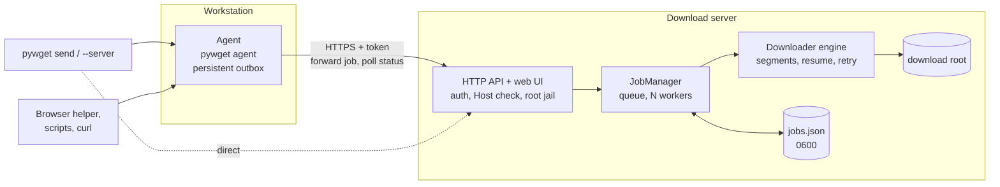

[](https://i.ibb.co/96D8hz7/pywget-architecture7.jpg)


### Job flow

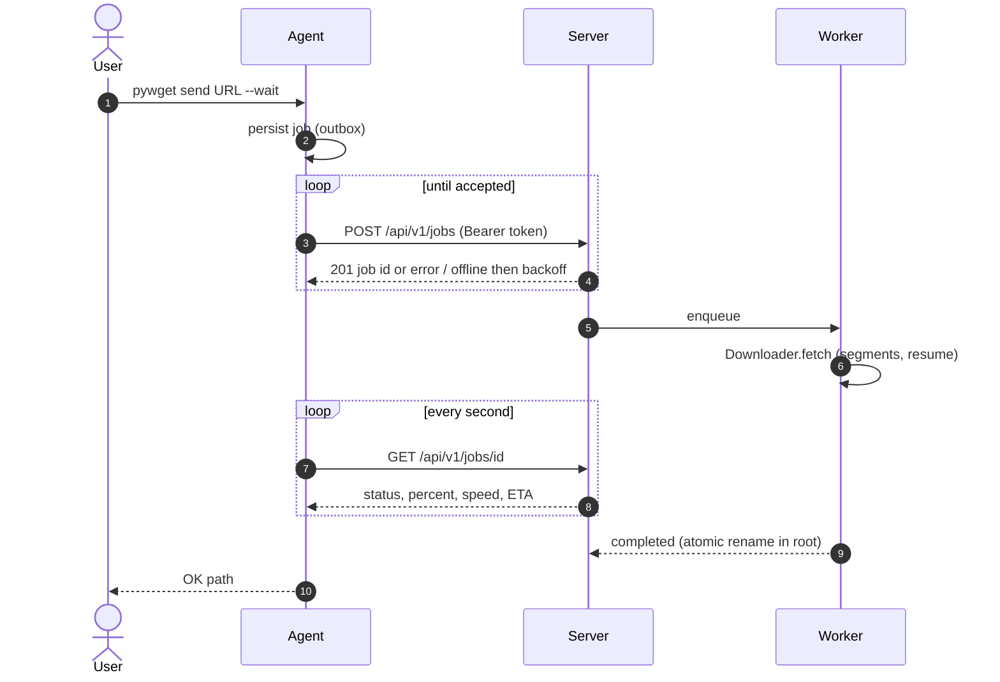

[](https://i.ibb.co/4n0GBmSD/pywget-architecture8.jpg)

### Job states

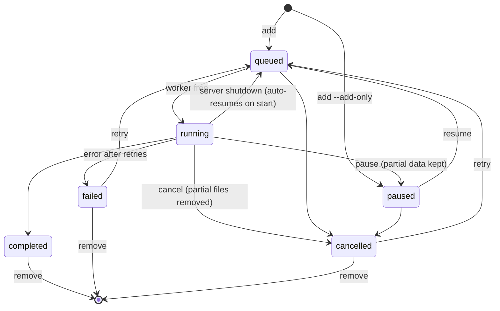

[](https://i.ibb.co/wNkVB4fp/pywget-architecture9.jpg)

### HTTP API

All `/api/v1/*` calls need `Authorization: Bearer <token>` (or `X-Pywget-Token`).

| Method and path | Purpose |
|-----------------|---------|
| `GET /health` | Liveness, version, mode (no auth) |
| `GET /` | Web UI (no auth, token entered in the page) |
| `POST /api/v1/jobs` | Create job(s): a job object, `{"urls": [...], ...common}` or `{"jobs": [...]}` |
| `GET /api/v1/jobs[?status=]` | List jobs |
| `GET /api/v1/jobs/{id}` | One job (secrets are never returned) |
| `POST /api/v1/jobs/{id}/pause\|resume\|cancel\|retry` | Control a job |
| `DELETE /api/v1/jobs/{id}` | Remove a finished job record |
| `GET /api/v1/stats` | Counts, total speed |
| `GET /api/v1/events` | Server-sent events (`event: job`) |

Job fields: `url`, `filename`, `path` (folder below the root), `referrer`, `cookie`
(string or object), `headers`, `user_agent`, `username`, `password`, `connections`,
`checksum`, `limit_rate`, `overwrite`, `add_only`.

```bash
curl -s -H "Authorization: Bearer $(cat ~/.config/pywget/token)" \
     -d '{"url":"https://example.com/f.iso","path":"isos","referrer":"https://example.com/"}' \
     http://127.0.0.1:8765/api/v1/jobs
```

### Polling job status

A job moves `queued -> running -> completed | failed | cancelled` (or `paused`). There are four ways to follow it:

| Method | Use it when |
|--------|-------------|
| `pywget send ... --wait` | one-off: send and block until done |
| `pywget jobs watch [ID ...]` | live view in a terminal (`--json` = one JSON object per line, exit code 1 if any job failed) |
| `ServerClient.wait / wait_all / watch` | Python code that polls for you |
| `GET /api/v1/jobs/{id}` in a loop | any language / `curl` |
| `ServerClient.events()` or `GET /api/v1/events` | push (server-sent events) instead of polling |

```bash
pywget jobs watch                      # all jobs, ends when nothing is queued or running
pywget jobs watch 78e2a219f26f --interval 0.5 --timeout 3600
```

Python (library):

```python
from pywget import ServerClient

client = ServerClient("http://127.0.0.1:8765")      # token: $PYWGET_TOKEN or the token file
job = client.submit({"url": "https://example.com/big.iso", "path": "isos"})[0]

# 1) live progress - yields whenever status / percent / error changes
for j in client.watch([job["id"]], interval=0.5):
    print(f'{j["status"]:<9} {j["percent"] or 0:5.1f}%  {j["speed"] / 1e6:4.1f} MB/s  ETA {j["eta"]}')

# 2) block until one job is finished (raises ServerError on timeout)
final = client.wait(job["id"], interval=1.0, timeout=3600)
print(final["status"], final["result_path"])

# 3) many jobs at once
jobs = client.submit({"urls": ["https://example.com/a.iso", "https://example.com/b.iso"], "path": "isos"})
finals = client.wait_all([j["id"] for j in jobs], interval=1.0)
print("failed:", [j["name"] for j in finals if j["status"] != "completed"])
```

Plain polling with only the standard library (the same loop works in any language):

```python
import json, time, urllib.request

BASE, TOKEN = "http://127.0.0.1:8765", open("/path/to/token").read().strip()

def call(method, path, body=None):
    request = urllib.request.Request(
        BASE + path, method=method,
        data=json.dumps(body).encode() if body is not None else None,
        headers={"Authorization": f"Bearer {TOKEN}", "Content-Type": "application/json"},
    )
    with urllib.request.urlopen(request, timeout=10) as response:
        return json.load(response)

job = call("POST", "/api/v1/jobs", {"url": "https://example.com/big.iso"})["jobs"][0]
deadline = time.monotonic() + 600
while True:
    job = call("GET", f"/api/v1/jobs/{job['id']}")
    print(job["status"], job["percent"])
    if job["status"] in ("completed", "failed", "cancelled"):
        break
    if time.monotonic() > deadline:
        raise TimeoutError("job still running")
    time.sleep(1)
```

Push instead of poll (server-sent events):

```python
for event in client.events():                       # {"event": "job", "job": {...}}
    job = event["event"] == "job" and event["job"]
    if job and job["status"] in ("completed", "failed", "cancelled"):
        print(job["name"], job["status"])
        break
```

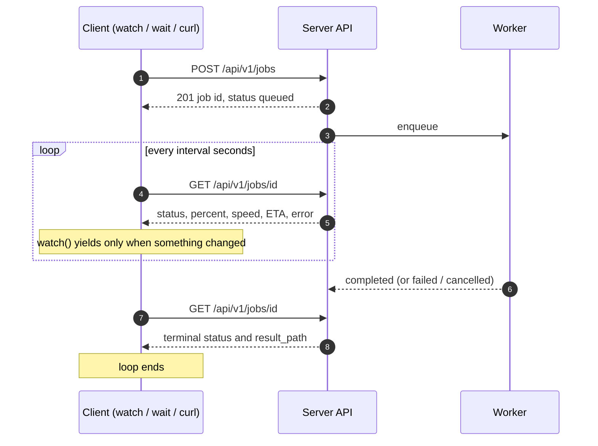

[](https://i.ibb.co/S73h5H3Q/pywget-architecture10.jpg)

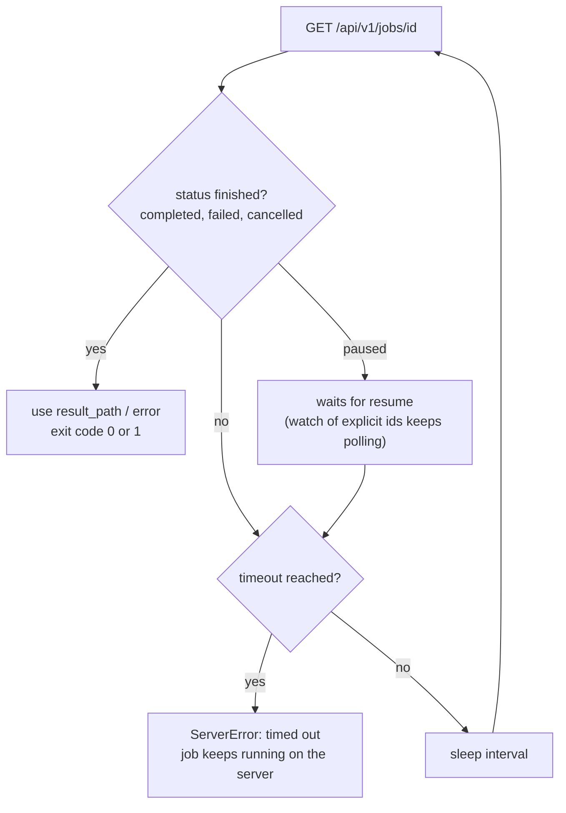

[](https://i.ibb.co/Ld9cD29F/pywget-architecture11.jpg)

### Security model

- **Token required** for every API call; generated once (`token` file, mode 0600) or given via `--token` / `$PYWGET_TOKEN`; compared in constant time.
- **Loopback by default.** Binding elsewhere prints a warning; use `--tls-cert/--tls-key` or an HTTPS reverse proxy.
- **Root jail:** job `path` can never leave `--root` (absolute paths and `..` are rejected, symlinks resolved).
- **No CORS** and a `Host` header allow-list (`--allowed-host`) against DNS-rebinding and drive-by browser requests.
- **`--deny-private-networks`** refuses URLs resolving to private/loopback/link-local addresses (SSRF guard for exposed servers).
- Request bodies capped at 1 MiB; headers checked for CR/LF injection; credentials and cookies are stored in `jobs.json` (0600) and never returned by the API.
- Not supported: POST-body downloads (IDM `post data`), FTP.

## How it works

### Download engine

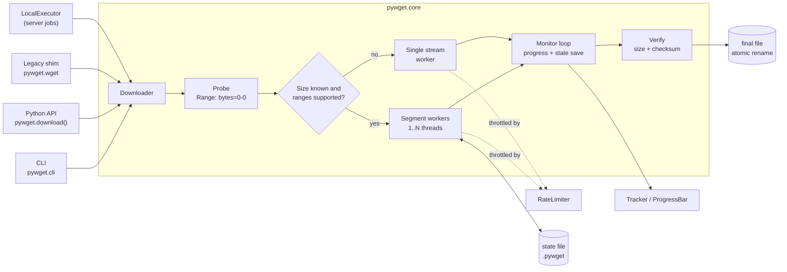

[](https://i.ibb.co/BVCnttHQ/pywget-architecture1.jpg)

### Download sequence

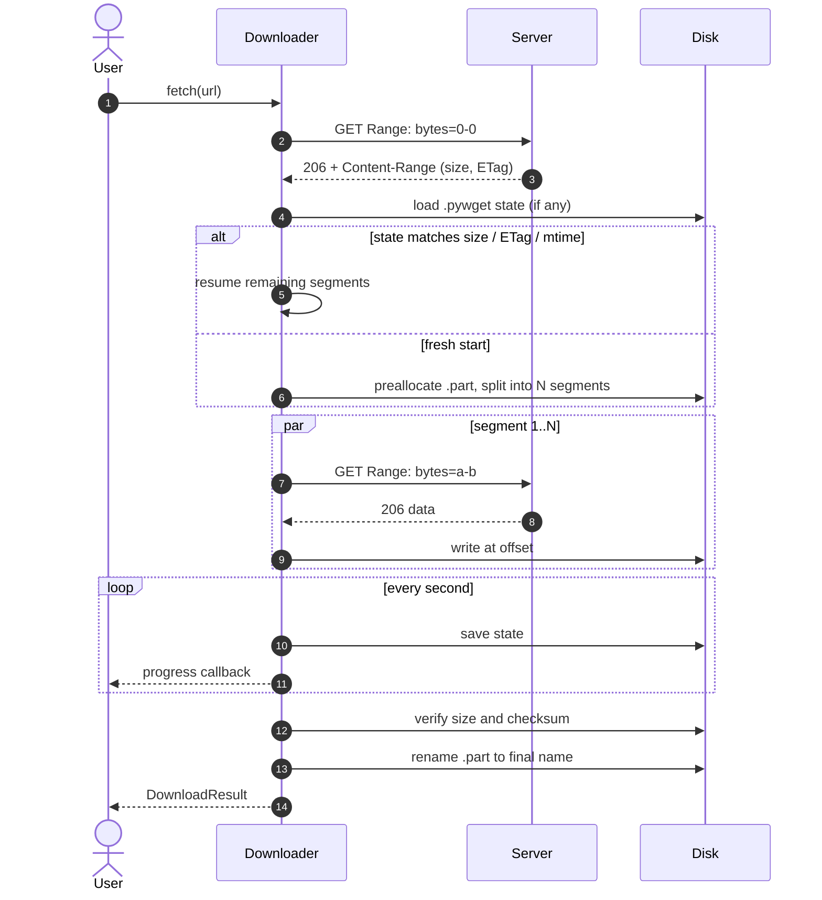

[](https://i.ibb.co/DPgLTD6D/pywget-architecture2.jpg)

### Segment lifecycle and retries

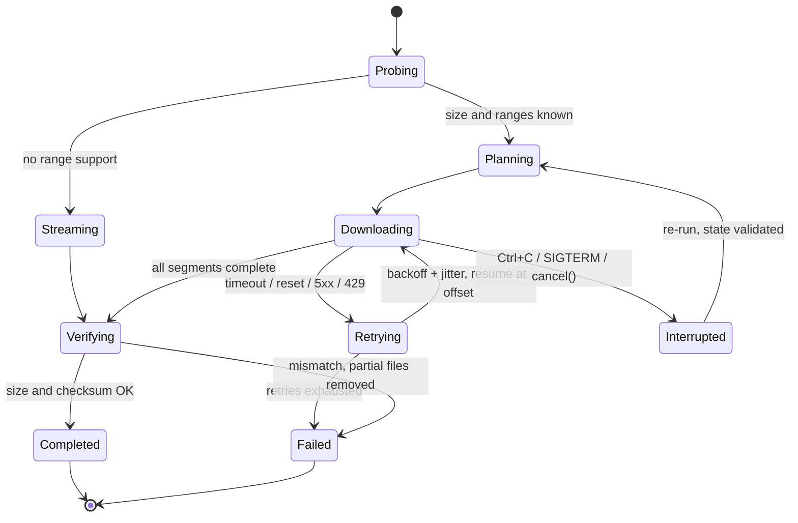

[](https://i.ibb.co/YBZKFsxG/pywget-architecture3.jpg)

### Resume decision

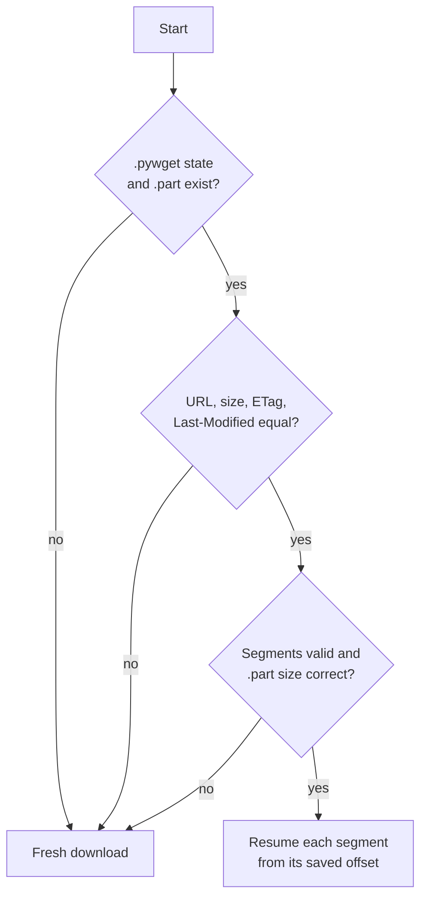

[](https://i.ibb.co/nqGmzdpw/pywget-architecture4.jpg)

### Main types - engine

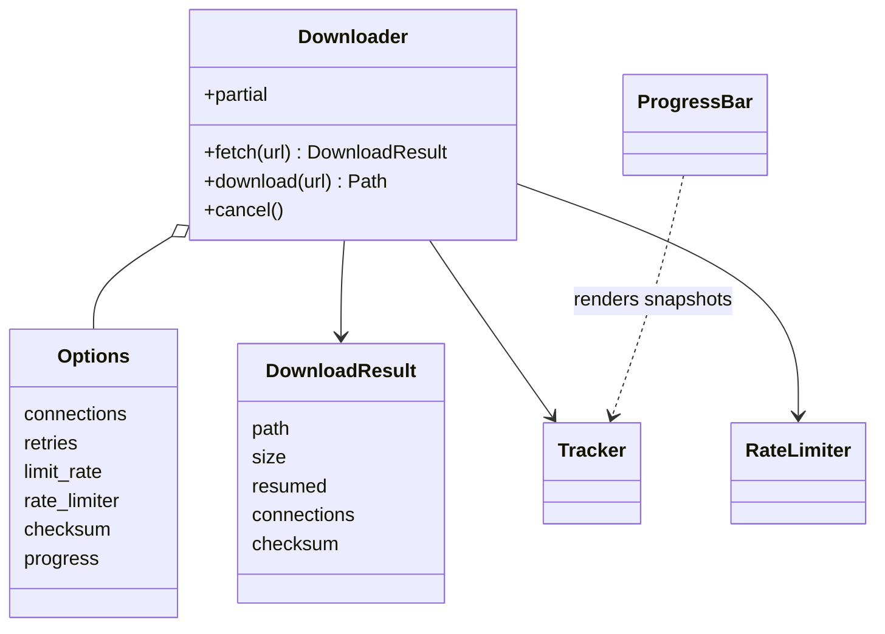

[](https://i.ibb.co/d0kCy05W/pywget-architecture5.jpg)

### Main types - server and agent

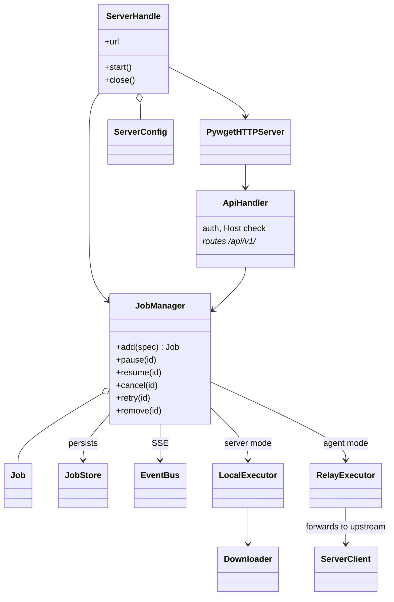

[](https://i.ibb.co/zVMXCFtz/pywget-architecture6.jpg)

### Module map

| Module | Role |
|--------|------|
| `pywget.core` | Download engine (`Downloader`, `Options`) |
| `pywget.progress`, `pywget.utils`, `pywget.errors` | Progress bar, helpers, exceptions and exit codes |
| `pywget.cli` | CLI: direct download, `serve`, `agent`, `send`, `jobs` |
| `pywget.server` | HTTP API, SSE, web UI hosting (`ServerHandle`, `run_server`) |
| `pywget.jobs` | `Job`, `JobManager`, persistence, `LocalExecutor` / `RelayExecutor` |
| `pywget.client` | `ServerClient`: submit, control, `wait` / `wait_all` / `watch` (polling), `events` (SSE) |
| `pywget.config` | Config file, token file and validation, `ServerConfig` |
| `pywget.clipboard` | `c` input: clipboard and URL extraction |
| `pywget.webui` | Embedded single-page web UI |
| `pywget.wget` | Backward-compatible `wget.download()` |

## Behaviour details

- **Probing:** one `Range: bytes=0-0` request yields size, range support, ETag, `Last-Modified` and `Content-Disposition`.
- **Segments:** a file is split into `min(connections, size / 2 MiB)` parts; small files use one connection.
- **Rate-limited servers:** on HTTP 429 the number of simultaneous segment requests is reduced automatically (down to 1) instead of failing the job; failed jobs keep partial data, so `pywget jobs retry ID` resumes.
- **Output hygiene:** messages and job lists show `host/../file` only - query strings (often signed tokens) are never printed.
- **Existing file:** same size means skipped; different size is saved as `name.1` (wget style) unless `--overwrite`.
- **Partial files:** stored as `name.part` + `name.pywget`; removed on success. Changed remote file (size/ETag/mtime) restarts cleanly.
- **Redirects:** only http/https; `Authorization`/`Cookie` are dropped when the origin changes.
- **Server jobs:** persisted in `jobs.json`; a job running at shutdown is re-queued and resumes from its `.part` data.
- **Not supported (by design):** FTP, recursive mirroring, POST-body downloads.

## Development

```bash
git clone https://github.com/cumulus13/pywget && cd pywget
pip install -e ".[dev]"
pytest --cov=pywget
ruff check pywget tests && mypy pywget
python -m build
```

## License

[BSD](LICENSE)

## Author

[Hadi Cahyadi](https://github.com/cumulus13)

[](https://www.buymeacoffee.com/cumulus13)
[](https://ko-fi.com/cumulus13)
[Support me on Patreon](https://www.patreon.com/cumulus13)
