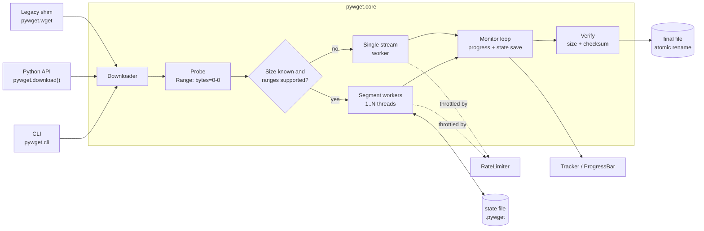
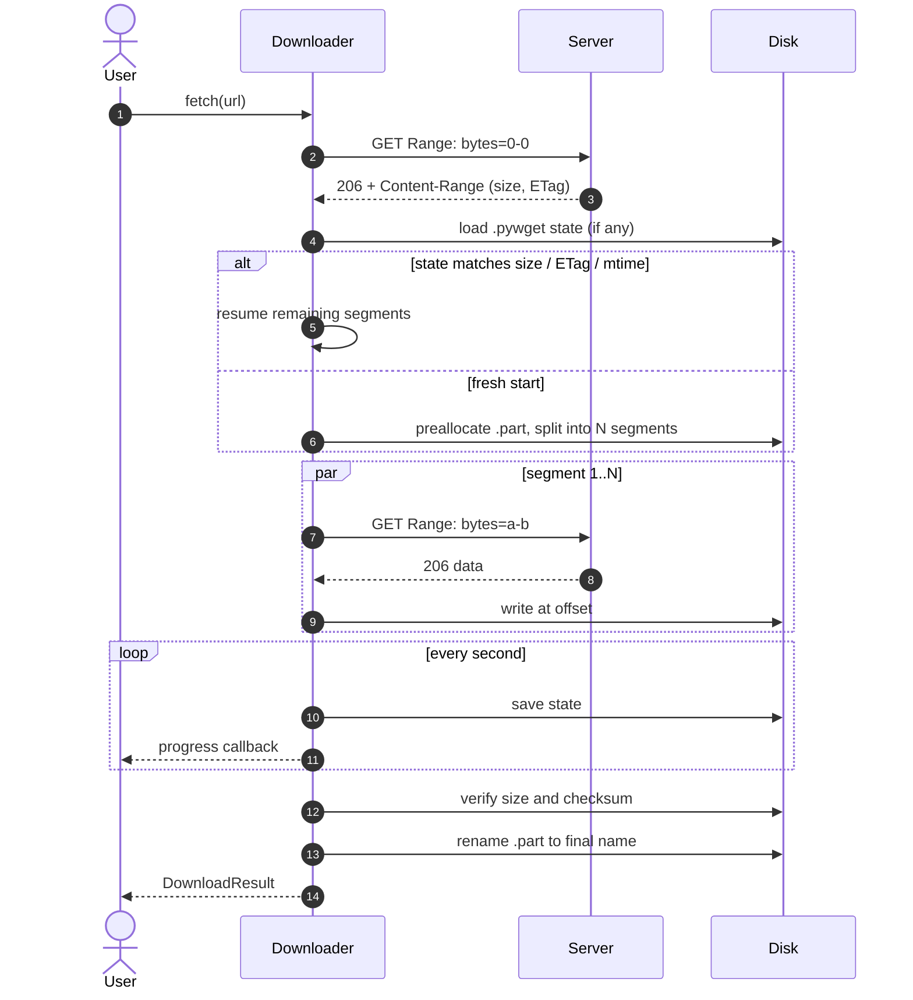
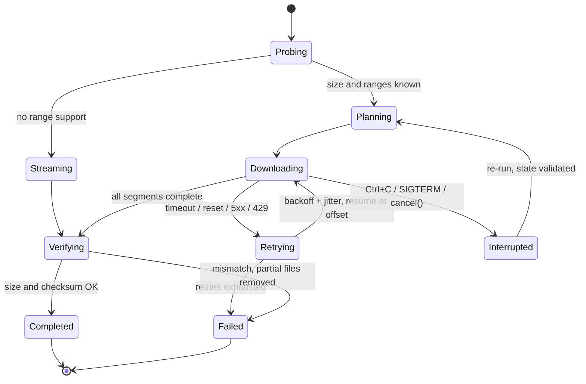
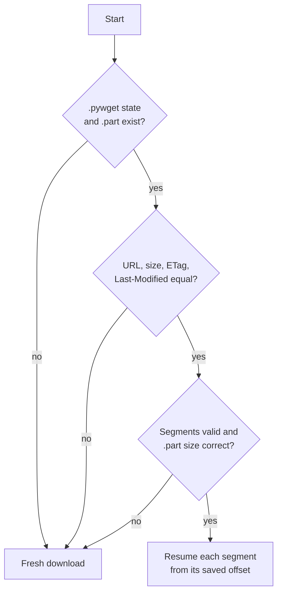
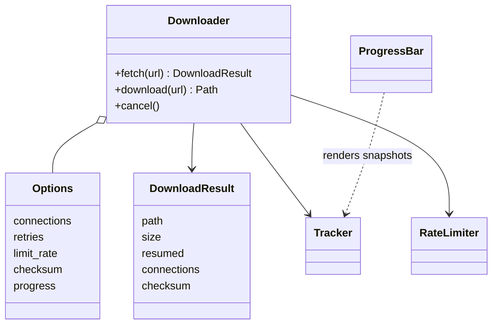

# pywget

[](https://github.com/cumulus13/pywget/actions/workflows/ci.yml)
[](https://pypi.org/project/pywget/)
[](https://pypi.org/project/pywget/)
[](LICENSE)

A robust, resumable, **multi-connection** command-line downloader and Python library.
A drop-in-style `wget` alternative with zero third-party dependencies.

## Features

| Area | What you get |
|------|--------------|
| Speed | Parallel segmented download (`-n 1..32`), automatic single-stream fallback |
| Reliability | Crash-safe resume, retries with exponential backoff + jitter, `Retry-After`, atomic rename |
| Integrity | `--checksum sha256:...`, size verification, disk-space pre-check |
| Security | http/https only, credentials stripped on cross-origin redirects, path-traversal-proof filenames, TLS verification on by default |
| Control | Bandwidth limit, custom headers, basic auth, proxy, custom CA, timeouts |
| Automation | Batch input (`-i`), `--json` output, stable exit codes, SIGINT/SIGTERM-safe |
| Library | Typed API, progress callbacks, cancel support, legacy `wget.download()` kept |
| Portability | Python 3.8+, Windows / Linux / macOS, no dependencies |

## Installation

```bash
pip install pywget
```

> **v2 note:** Python 2 is no longer supported. Python 3.8+ is required. The CLI and
> `wget.download(url, dir)` keep working as before.

## Quick start

```bash
# simple download into a directory (same as before)
pywget "https://example.com/file.iso" -p ~/Downloads

# 8 parallel connections, 2 MiB/s cap, verify checksum
pywget https://example.com/file.iso -n 8 --limit-rate 2M --checksum sha256:<hex>

# many URLs from a file (or stdin with -i -), JSON report
pywget -i urls.txt -p downloads --json

# auth + custom header
pywget https://api.example.com/export.zip --user me -H "Accept: application/zip"
```

Interrupted (Ctrl+C, crash, network loss)? Run the same command again - it resumes.

## CLI reference

| Option | Description |
|--------|-------------|
| `URL ...` | One or more http(s) URLs |
| `-i, --input-file FILE` | Read URLs from file (`-` = stdin); `#` comments allowed |
| `-p, -P, --path DIR` | Download directory (default `.`) |
| `-O, --output NAME` | Output file name (single URL) |
| `-n, --connections N` | Parallel connections per file, 1-32 (default 4) |
| `-r, --retries N` | Retries per request/segment (default 5) |
| `-T, --timeout SEC` | Network timeout (default 30) |
| `--limit-rate RATE` | Total speed cap, e.g. `500k`, `2M` |
| `-H, --header 'K: V'` | Extra header (repeatable) |
| `-U, --user-agent UA` | Custom User-Agent |
| `--user`, `--password` | Basic auth (password also from `PYWGET_PASSWORD` or prompt) |
| `--proxy URL` | Proxy (default: environment) |
| `--no-check-certificate` | Disable TLS verification (not recommended) |
| `--ca-cert FILE` | Custom CA bundle |
| `--checksum ALGO:HEX` | Verify result (md5, sha1, sha256, sha512, ...) |
| `--overwrite` | Replace existing file and restart |
| `--no-resume` | Never resume partial files |
| `--no-mtime` | Do not copy `Last-Modified` to the file |
| `-q`, `-v` | Quiet / debug logging |
| `--json` | Machine-readable results on stdout |
| `-c` | Accepted for wget compatibility (resume is default) |

### Exit codes

| Code | Meaning |
|------|---------|
| 0 | Success |
| 1 | Unexpected error |
| 2 | Bad usage / invalid URL |
| 3 | Network error |
| 4 | HTTP error status (404, 403, ...) |
| 5 | Checksum mismatch |
| 6 | Storage / I/O error (disk full, permissions) |
| 130 | Interrupted (partial data kept for resume) |

## Python API

```python
import pywget

path = pywget.download(
    "https://example.com/file.iso",
    "/data/downloads",
    progress=True,          # terminal bar
    connections=8,
    limit_rate="5M",
    checksum="sha256:ab12...",
)
print(path)
```

Full control:

```python
from pywget import Downloader, Options, ProgressInfo

def on_progress(p: ProgressInfo) -> None:
    print(f"{p.filename}: {p.percent or 0:.1f}%  {p.speed/1e6:.1f} MB/s  ETA {p.eta}")

dl = Downloader(Options(output_dir="out", retries=8, progress=on_progress,
                        headers={"Authorization": "Bearer TOKEN"}))
result = dl.fetch("https://example.com/big.bin")
print(result.path, result.size, result.resumed, result.connections)

# from another thread: dl.cancel()  -> partial state is kept for resume
```

Legacy API (unchanged):

```python
from pywget import wget

wget.download("http://www.test.com/test.tar.gz", "/home/root/Downloads")
```

Errors derive from `pywget.PywgetError` (`InvalidURLError`, `NetworkError`,
`HTTPStatusError`, `ChecksumError`, `StorageError`, `DownloadCancelled`).
A `Downloader` runs one download at a time - use one instance per thread.

## How it works

### Architecture



[](https://i.ibb.co/mr6hxjYg/pywget-architecture1.jpg)

### Download sequence



[](https://i.ibb.co/DPgLTD6D/pywget-architecture2.jpg)

### Segment lifecycle and retries



[](https://i.ibb.co/YBZKFsxG/pywget-architecture3.jpg)

### Resume decision



[](https://i.ibb.co/nqGmzdpw/pywget-architecture4.jpg)

### Main types



[](https://i.ibb.co/9HYQ3WrT/pywget-architecture5.jpg)

## Behaviour details

- **Probing:** one `Range: bytes=0-0` request yields size, range support, ETag, `Last-Modified` and `Content-Disposition`.
- **Segments:** a file is split into `min(connections, size / 2 MiB)` parts; small files use one connection.
- **Existing file:** same size means skipped; different size is saved as `name.1` (wget style) unless `--overwrite`.
- **Partial files:** stored as `name.part` + `name.pywget`; removed on success. Changed remote file (size/ETag/mtime) restarts cleanly.
- **Redirects:** only http/https; `Authorization`/`Cookie` are dropped when the origin changes.
- **Not supported (by design):** FTP, recursive mirroring.

## Development

```bash
git clone https://github.com/cumulus13/pywget && cd pywget
pip install -e ".[dev]"
pytest --cov=pywget
ruff check pywget tests && mypy pywget
python -m build
```

## License

[BSD](LICENSE)

## Author

[Hadi Cahyadi](https://github.com/cumulus13)

[](https://www.buymeacoffee.com/cumulus13)
[](https://ko-fi.com/cumulus13)
[Support me on Patreon](https://www.patreon.com/cumulus13)
